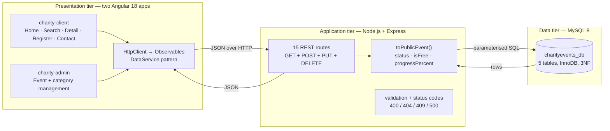
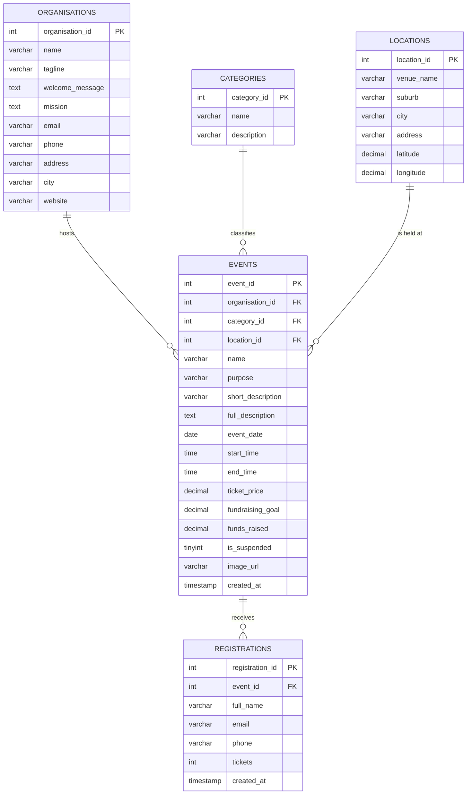

# Harbour Hope Charity Events — Project Report

**Unit:** PROG2002 Web Development II
**Assessment:** 3 — full-stack dynamic website with a data layer, REST APIs, and two Angular websites
**Organisation (fictional):** Harbour Hope Foundation, Gold Coast
**Repository:** private GitHub repository, marker invited as a collaborator

---

## How this report maps to the assessment outline

| # | Required section | Where it is answered |
| --- | --- | --- |
| 1 | Title | Header above |
| 2 | Introduction / Motivation | [§1](#1-introduction-and-motivation) |
| 3 | Problem Statement | [§2](#2-problem-statement) |
| 4 | Solution | [§3](#3-solution) |
| 5 | Web UX | [§4](#4-web-ux) |
| 6 | Data Schema | [§5](#5-data-schema) |
| 7 | API design | [§6](#6-api-design) |

Supporting sections: [§7 Testing](#7-testing-performed), [§8 Limitations](#8-limitations-and-future-work), [§9 Academic integrity](#9-academic-integrity).

---

## 1. Introduction and Motivation

**Harbour Hope Foundation** is a fictional Gold Coast not-for-profit that raises money through
ticketed community events: fun runs, gala dinners, silent auctions, concerts, and free community
fairs. Each event is tied to one named local cause — emergency housing deposits, youth
mental-health counselling, school-holiday food relief, or coastal dune restoration.

The organisation needs a **public website**, not an internal system. Its purpose is to let a
stranger who has never heard of Harbour Hope understand the mission in under a minute, find an
event near them, and commit to a ticket. Ticket revenue is the fundraising mechanism, so every
step between "I heard about this charity" and "I bought a ticket" is revenue at risk.

**Why this project is worth building.** Small charities typically run their events page on a
generic donation platform that shows a flat list with no filtering and no context. A visitor who
wants "a free family thing in Robina this month" has to scroll and guess. Giving the charity its
own site — with real search, honest progress figures, a live weather forecast for each venue, and
online registration — directly increases conversion on the same audience.

**Scope of Assessment 3.** This assessment extends the Assessment 2 read-only site into a
**complete create/read/update/delete system**. Two things are new:

1. **A write path.** Visitors can register for an event (name, email, phone, tickets), and the
   booking is stored in MySQL with a duplicate-email guard.
2. **A staff administration site.** Staff can create, edit, suspend, and delete events, manage the
   category list, and inspect who has registered for each event — all through a second Angular
   website served under `/admin/`.

Critically, the two client websites are now built with **Angular 18** rather than hand-written
DOM code, which the brief explicitly rewards with additional marks.

---

## 2. Problem Statement

Harbour Hope needs to publish a changing list of fundraising events to an unknown public audience,
and its staff need to maintain that list without editing HTML. Six concrete problems follow.

**P1 — Visitors cannot find a relevant event.** The audience is not homogeneous. Some want any
free family activity, some want a formal gala, some will travel only to a specific suburb, and some
are looking for something on one particular date. The site must support filtering by **date,
location, and category**, in any combination.

**P2 — The site must never show stale or withdrawn information.** Advertising an event that has
already happened, or one staff have suspended, is damaging for a charity. Past events must be
**excluded from the default listing but still findable**; suspended events must be **invisible
everywhere**. This rule is enforced by the data layer, not by asking staff to remember.

**P3 — Supporters do not trust a progress bar they cannot trace.** Harbour Hope names the specific
cause each event funds and shows a goal-versus-progress figure per event, so a supporter can see
what their money does.

**P4 — Booking must be self-service and duplicate-safe.** A supporter must be able to register
without phoning the office, but the same email address must not be able to book the same event
twice. The database must reject duplicates at the engine level, not merely in application code.

**P5 — Staff need an administration tool, not a SQL client.** Creating an event involves a dozen
fields across four related tables. Staff need a form that validates input and respects business
rules — such as "an event with registrations cannot be deleted, only suspended" — without needing
to know SQL.

**P6 — A hard technical constraint.** The brief requires **Node.js, Express, MySQL**, and a
**single-page front end**. Assessment 3 specifically rewards using **Angular** to build the two
websites, so the front end is implemented as two Angular 18 applications sharing one REST API.

### Success criteria

The build is successful when a marker — or a real visitor — can:

1. open the home page and see only current and upcoming events;
2. search by any combination of date, location, and category and get correct results;
3. open one event and see its full description, price (or **Free**), honest progress, and a
   venue weather forecast;
4. register for an event and have the booking stored, with a duplicate email rejected;
5. never see a suspended event anywhere, through any URL;
6. log into the admin site and create, edit, suspend, and delete events and categories;
7. do all of the above with the front end built in **Angular**, not hand-written DOM code.

---

## 3. Solution

### 3.1 Architecture — three tiers, two Angular front ends

The project is a three-tier application with two browser clients. Each tier has one job.



*Figure 1 — client–server flow. Two Angular apps talk to one Express API; neither browser ever
talks to MySQL directly.*

What travels across each boundary:

| Boundary | Carries | Format |
| --- | --- | --- |
| Angular router → component | the event id from the `:id` route parameter | URL (hash route) |
| Component → service | a method call returning an `Observable` | RxJS |
| Service → server | `GET`/`POST`/`PUT`/`DELETE` over `/api/…` | HTTP + JSON |
| Server → database | `SELECT … WHERE is_suspended = 0 …`, `INSERT`, `UPDATE`, `DELETE` | parameterised SQL |
| Server → service | one object, or an array of objects | JSON, camelCase |
| Service → template | component state bound to `@if` / `@for` | change detection |

**One worked round trip.** A visitor opens the event detail route `#/event/3`. The
`EventDetailComponent` reads `3` from the route, calls `api.getEvent(3)`, and subscribes to the
returned `Observable`. Express binds `3` as a parameter, runs a `SELECT` that joins `events` to
`organisations`, `categories`, and `locations`, maps the row through `toPublicEvent()`, and returns
JSON. Angular's `@if`/`@for` control flow renders the result. If the id is unknown *or* the event
is suspended, the server answers `404` and the component shows the error banner.

### 3.2 Why this stack

| Decision | Reason |
| --- | --- |
| MySQL | Relational data with genuine one-to-many relationships; foreign keys and `CHECK` constraints enforce the domain in the data tier, and `DECIMAL` keeps money exact. |
| Express | Minimal, unopinionated, and it satisfies the brief's dependency budget (`express`, `mysql2`, `dotenv`, `cors`) with no ORM. |
| `mysql2` promise pool | Prepared statements protect against SQL injection by construction; the pool keeps connections healthy under concurrent writes. |
| **Angular 18** | Required by the brief for extra marks. Two standalone apps (`charity-client`, `charity-admin`) share one API, mirroring the MEAN architecture taught in the course. |
| HttpClient + Observables | A single `ApiService` per app wraps every endpoint and centralises error handling, following the course's DataService pattern. |
| Hash routing | `withHashLocation()` means every route loads the same `index.html` shell, so no server-side rewrite rule is needed and the site works from a plain static host. |
| Open-Meteo | A free, key-less weather API powers the venue forecast panel; coordinates live on the `locations` table so no hard-coding is needed. |
| Local images | Event photos are served by the same Express origin, so the site renders with no third-party image dependency. |

### 3.3 What each tier does

| Actor | Goal | Flow |
| --- | --- | --- |
| Visitor | Understand the charity | Home → `GET /api/organisation` → welcome, mission, contact |
| Visitor | See what is coming up | Home → `GET /api/events` → card grid (upcoming, active only) |
| Visitor | Find something specific | Search → `GET /api/events/search?…` → filtered cards |
| Visitor | Judge one event | Detail → `GET /api/events/:id` + Open-Meteo → description, price, progress, weather |
| Visitor | Book a place | Register → `POST /api/events/:id/registrations` → `201` |
| Staff | Maintain the list | Admin → `GET/POST/PUT/DELETE` on `/api/events` and `/api/categories` |

---

## 4. Web UX

### 4.1 The two websites

The front end is two Angular applications that share one stylesheet, one set of domain models,
and one API.

| Site | Routes (hash) | Purpose |
| --- | --- | --- |
| **Public** (`charity-client`) | `#/`, `#/search`, `#/event/:id`, `#/register/:id`, `#/contact` | Browse, search, view, register |
| **Admin** (`charity-admin`) | `/admin/` | Event + category management |

Every page loads the same sticky header, so the visitor always knows where they are and can
always get back. The admin site has its own header with a link back to the public site.

### 4.2 Pages (public)

| Page | Route | Purpose |
| --- | --- | --- |
| Home | `#/` | Organisation story, mission, impact stats, upcoming event cards |
| Search | `#/search` | Date / location / category form, results, clear-filters |
| Event details | `#/event/:id` | Full description, tickets, goal vs progress, **weather panel**, recent registrations |
| Register | `#/register/:id` | Registration form (name / email / phone / tickets) |
| Contact | `#/contact` | Organisation contact details from the API, message-form shell |

### 4.3 Wireframe — event detail (representative)

```text
┌───────────────────────────────────────────────────────────────┐
│ [◆] Harbour Hope          Home  Search  Contact  Donate  Admin│
├───────────────────────────────────────────────────────────────┤
│  [ event image ]                     [ Fun Run ] [ Upcoming ] │
│                                      Sunrise Harbour 10k      │
│                                      Emergency housing …      │
│                                      Mon, 12 Oct · 6:30–10am  │
│                                      Broadwater Parklands …   │
├───────────────────────────────────────────────────────────────┤
│  About this event                                              │
│  [ full description ]                                          │
│  ┌─ Tickets ────────────┐  ┌─ Goal vs progress ─────────────┐ │
│  │ Price: Free          │  │ ▓▓▓▓▓▓░░░░░░ 45%               │ │
│  └──────────────────────┘  └─────────────────────────────────┘ │
│  ┌─ Weather at the venue ────────────────────────────────────┐ │
│  │  22°C  Mon 24/18  Tue 25/19  Wed 23/17  …                 │ │
│  └────────────────────────────────────────────────────────────┘ │
│  ┌─ Recent registrations ─────────────────────────────────────┐ │
│  │  Taylor Example                   2 tickets                │ │
│  └────────────────────────────────────────────────────────────┘ │
│  ┌─ Would you like to join? ─────────────────────────────────┐ │
│  │  [ Register for this event ]                              │ │
│  └────────────────────────────────────────────────────────────┘ │
└───────────────────────────────────────────────────────────────┘
```

### 4.4 Admin dashboard

The admin site is a single dashboard with two panels: an **event list** with a create/edit editor
on the right, and a **category manager** below. The editor exposes every event field, including a
"suspend" checkbox, and shows the event's registrations inline when editing. Deletes are guarded:
an event with registrations, or a category still used by events, is rejected by the server with a
human-readable reason.

### 4.5 Accessibility and responsiveness

- A **skip link** is the first tab stop on every page.
- Interactive elements show a high-contrast `:focus-visible` outline for keyboard users.
- The design is responsive: multi-column layouts collapse to a single column under 860 px.
- `prefers-reduced-motion` disables animations and smooth scrolling.
- Loading states use `role="status"` / `aria-live="polite"` so screen readers announce progress.
- Angular's default text interpolation escapes user and database content, preventing stored-XSS.

---

## 5. Data Schema

### 5.1 Entity-relationship diagram



*Figure 2 — five tables in third normal form. `locations` now carries `latitude`/`longitude` for
the weather panel; `registrations` is populated by the booking form.*

### 5.2 Design principles

- **Third normal form via lookup tables.** "Fun Run" is stored once in `categories`; "Southport" is
  stored once in `locations`. Only the integers repeat on `events`.
- **Surrogate integer keys.** Every table has an `INT UNSIGNED AUTO_INCREMENT` primary key.
- **Referential integrity with restraint.** `events` uses `ON DELETE RESTRICT` for its foreign
  keys; `registrations` uses `ON DELETE CASCADE`, because a registration has no meaning without
  its event.
- **Soft delete, not hard delete.** `is_suspended` is a flag. A suspended event keeps its history
  and can be reinstated; nothing is lost.
- **Money is exact.** `ticket_price`, `fundraising_goal`, and `funds_raised` are `DECIMAL`.
- **Free events are a price, not a table.** `ticket_price = 0` means free; the API derives `isFree`.
- **Constraints in the database.** `CHECK` constraints reject a negative price, a non-positive
  goal, or an `end_time` not after `start_time`. A `UNIQUE (event_id, email)` key on
  `registrations` rejects a double booking at the engine level.
- **Coordinates for weather.** `locations.latitude` / `longitude` (nullable `DECIMAL(9,6)`) feed
  the Open-Meteo forecast; venues without coordinates simply omit the weather panel.
- **Indexes for the actual queries.** `idx_events_date`, `idx_events_suspended`, and
  `idx_events_category` cover the home listing and each search filter.

### 5.3 Tables at a glance

| Table | Rows seeded | Role |
| --- | --- | --- |
| `organisations` | 1 | The charity's public profile and contact details |
| `categories` | 5 | Fun Run, Gala Dinner, Silent Auction, Concert, Community Fair |
| `locations` | 7 | Venue, suburb, city, address, and coordinates for the Gold Coast |
| `events` | 11 | The fundraising events themselves |
| `registrations` | 10 | Sample bookings demonstrating the newest-first ordering |

### 5.4 Sample data, chosen to prove the rules

| Data | Why it exists |
| --- | --- |
| 8 upcoming events across all 5 categories and 7 locations | A realistic, non-trivial list to search |
| 2 **past** events | Proves the home page hides them while search can still find them |
| 1 **suspended** event (id 11) | Proves it is invisible on the home page, in search, and on direct lookup |
| 1 **free** event (`ticket_price = 0`) | Proves the derived `isFree` flag and the **Free** pill |
| 1 overdue event (raised 10,800 of a 10,000 goal) | Proves the progress figure can legitimately exceed 100 % |
| 10 **registrations** across events | Proves the booking list and the duplicate-email `409` guard |

### 5.5 Connection layer

`event_db.js` exposes a single **`mysql2` promise pool**. Route handlers `await pool.query(sql,
params)`, so prepared statements are used for every value and credentials never appear in source
control — they are read from `.env` via `dotenv`, and `.env` is listed in `.gitignore`.

---

## 6. API Design

### 6.1 The endpoints

Fifteen routes, spanning all four HTTP methods. Resources are named with **nouns**; the verb lives
in the HTTP method.

| Method | URL | Purpose |
| --- | --- | --- |
| GET | `/api/organisation` | Charity profile (home + contact) |
| GET | `/api/categories` | Category list |
| GET | `/api/locations` | Venue list (with coordinates) |
| GET | `/api/events` | Current + upcoming, not suspended |
| GET | `/api/events/search` | Filtered active events (`date`, `location`, `categoryId`) |
| GET | `/api/events/:id` | Full detail + registrations |
| GET | `/api/events/:id/registrations` | Registrations for one event |
| POST | `/api/events/:id/registrations` | Create a registration |
| GET | `/api/admin/events` | All events (incl. past + suspended) |
| POST | `/api/events` | Create event |
| PUT | `/api/events/:id` | Update event |
| DELETE | `/api/events/:id` | Delete event (blocked if it has registrations) |
| POST | `/api/categories` | Create category |
| PUT | `/api/categories/:id` | Update category |
| DELETE | `/api/categories/:id` | Delete category (blocked if in use) |

Two ordering decisions matter. `/api/events/search` is registered **before** `/api/events/:id`,
otherwise Express would match the literal word `search` as an id. Collection endpoints return
summaries without `fullDescription`, while the detail and admin endpoints include it.

### 6.2 Worked example — the registration write

**`POST /api/events/:id/registrations`**

This is the endpoint that answers **P4**. It validates the body, confirms the event exists, is not
suspended, and has not already happened, then inserts the booking. The database's
`UNIQUE (event_id, email)` key is the final guard against duplicates.

```http
POST /api/events/1/registrations HTTP/1.1
Content-Type: application/json
Accept: application/json

{
  "fullName": "Taylor Example",
  "email": "taylor@example.com",
  "phone": "0400 123 456",
  "tickets": 2
}
```

| Field | Rule |
| --- | --- |
| `fullName` | string, 2–120 characters |
| `email` | valid email, ≤ 120 characters |
| `phone` | string, 5–40 characters |
| `tickets` | integer, 1–10 |

**Success — `201 Created`**

```json
{
  "message": "Registration completed successfully.",
  "registrationId": 11,
  "eventId": 1,
  "fullName": "Taylor Example",
  "tickets": 2
}
```

**Error — `409 Conflict`** (duplicate email)

```json
{ "error": "This email address has already registered for this event." }
```

### 6.3 Delete protection — transactions and business rules

Deleting an event is the most dangerous operation, so it is wrapped in a transaction that locks
the row with `FOR UPDATE`, counts its registrations, and refuses to delete when any exist:

```text
BEGIN
  SELECT … FROM events WHERE event_id = ? FOR UPDATE
  SELECT COUNT(*) FROM registrations WHERE event_id = ?
  -- if count > 0 → rollback, 409 "suspend it instead"
  DELETE FROM events WHERE event_id = ?
COMMIT
```

Category deletion is guarded similarly: a category still referenced by an event returns `409`.

### 6.4 Filtering and visibility rules

| Endpoint | Rule |
| --- | --- |
| `/api/events` (home) | `is_suspended = 0` **AND** `event_date >= CURDATE()` |
| `/api/events/search` | `is_suspended = 0`, plus supplied filters combined with `AND` |
| `/api/events/:id` | Same suspension rule; unknown id and suspended id both return `404` |
| `/api/admin/events` | No filter — includes past and suspended records for staff |
| `/api/organisation`, `/api/categories`, `/api/locations` | Reference data, no visibility rule |

### 6.5 Validation, security, and error contracts

| Concern | How it is handled |
| --- | --- |
| **SQL injection** | No SQL string is ever built by concatenation. Every value is a bound parameter. |
| **Input validation** | Dates, ids, email, phone, and ticket counts are validated server-side; invalid input returns `400`. |
| **Least data** | List endpoints omit `fullDescription`; only detail and admin include it. |
| **Consistent casing** | MySQL `snake_case` → JSON `camelCase` via one mapper (`toPublicEvent`). |
| **Error shape** | Every failure returns `{ "error": "…" }` with the right status code. |
| **CORS** | Enabled so the API can be exercised from Postman during marking. |
| **CSP** | `connect-src 'self' https://api.open-meteo.com` allows only the weather API as an external origin; everything else is same-origin. |
| **Security headers** | `nosniff`, `DENY` frame, strict referrer policy, and a restrictive CSP close the common attack classes. |
| **Static asset freshness** | HTML/CSS/JS served with `Cache-Control: no-cache`. |

**Status-code contract**

| Code | Meaning |
| --- | --- |
| `200` | Success (a search with no matches returns `200` + `[]`) |
| `201` | Resource created (registration, event, category) |
| `400` | Malformed request — invalid date, id, email, or missing field |
| `404` | Route or resource missing, including suspended events |
| `409` | Conflict — duplicate email, or a delete blocked by a business rule |
| `500` | Unexpected server/database failure |

---

## 7. Testing performed

The API was exercised over HTTP against the running server, and both Angular apps were built and
checked in a browser.

| # | Check | Expected | Result |
| --- | --- | --- | --- |
| 1 | `GET /api/organisation` | `200`, charity profile | Pass |
| 2 | `GET /api/events` | `200`, only active upcoming events | Pass |
| 3 | `GET /api/categories` | `200`, five categories | Pass |
| 4 | `GET /api/locations` | `200`, seven venues with coordinates | Pass |
| 5 | `GET /api/events/1` | `200`, full detail + registrations | Pass |
| 6 | `GET /api/events/9999` | `404` + `error` | Pass |
| 7 | `GET /api/events/11` (suspended) | `404` — suspension invisible | Pass |
| 8 | `search?location=Southport` | Southport events, past included | Pass |
| 9 | `search?categoryId=1` | All Fun Run events | Pass |
| 10 | `search` with no params | `400` + explanation | Pass |
| 11 | `POST /api/events/1/registrations` (valid) | `201` + registration id | Pass |
| 12 | `POST …/registrations` (duplicate email) | `409` + message | Pass |
| 13 | `POST …/registrations` (bad email) | `400` + message | Pass |
| 14 | `GET /api/admin/events` | `200`, includes past + suspended | Pass |
| 15 | `POST /api/events` (valid) | `201` + event id | Pass |
| 16 | `PUT /api/events/:id` (valid) | `200` + message | Pass |
| 17 | `DELETE /api/events/:id` (has registrations) | `409`, blocked | Pass |
| 18 | `POST /api/categories` / `PUT` / `DELETE` | CRUD works; in-use delete blocked | Pass |
| 19 | `ng build` for both Angular apps | Production bundle, no errors | Pass |
| 20 | Client serves at `/`, admin at `/admin/` | Both load their shell | Pass |

The public site was also exercised in a real browser: the home page renders only upcoming cards,
the search form filters correctly, the detail page populates every field and shows the weather
panel, and registration produces a success banner while a duplicate email shows the conflict
message.

---

## 8. Limitations and future work

**Known limitations**

- **No authentication.** The admin site is not yet protected by a login, so the admin endpoints
  are reachable by anyone who knows the URL. Session-based login with a role check is the obvious
  next step.
- **No real payment.** Registration records a booking, but no payment is processed. The ticket
  purchase is framed as a donation placeholder.
- **Progress is a stored total.** `funds_raised` is maintained as a figure rather than summed live
  from registrations.
- **A single organisation.** `organisations` holds one row, so there is no multi-tenant isolation.
- **Weather is optional.** Events at venues without coordinates show no forecast panel.

**Possible future work**

1. Session login with role-based access control on the admin endpoints.
2. Deriving `funds_raised` from confirmed registrations instead of storing it directly.
3. A payment integration, so registration becomes a real purchase.
4. Server-side rendering or pre-rendering for the Angular apps, for faster first paint and SEO.

---

## 9. Academic integrity

Harbour Hope Foundation is an invented organisation and none of its events, venues, or contact
details describe a real charity. The schema, the fifteen API routes, and the two Angular websites
were built for this assessment against the brief: **Node.js, Express, Angular 18, and MySQL**.
Back-end dependencies are limited to `express`, `mysql2`, `dotenv`, and `cors`; the front ends use
Angular's own libraries plus `rxjs` and `zone.js`. Weather data comes from the free
**Open-Meteo** API.

Images are royalty-free photographs bundled into each Angular app and served from the project
itself, so the site does not depend on any external image host.

**Submission checklist**

- [x] Database script, connection module, server, and two Angular websites
- [x] Private GitHub repository with the marker invited as a collaborator
- [x] Regular commits with descriptive messages
- [ ] Demonstration video (maximum 15 minutes), uploaded to OneDrive with a share link
